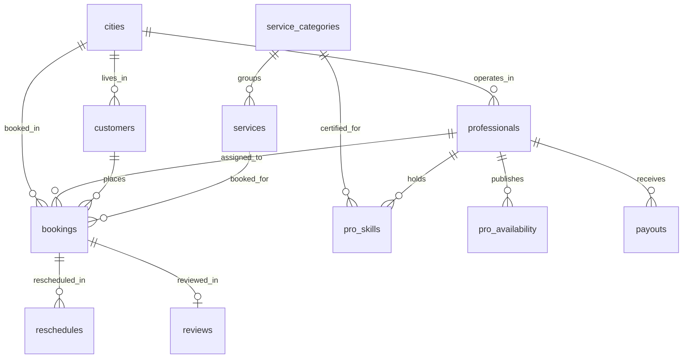

# Phase 2: Schema Design

We based this schema design (`sql/01_schema.sql`) on the 11 CSV exports in `seed_data/` and loaded all tables into the `uc` schema in PostgreSQL (`sql/02_load_data.sql`). The schema uses PostgreSQL types that keep money exact (`numeric`), retain the UTC`+05:30` offset in timestamps (`timestamptz`), and treat phone numbers and pincodes as text identifiers rather than numbers.

## Tables and columns

`PK` is a primary key, `FK` is a foreign key, `UQ` is unique, `NN` is not null, and `CK` is a check constraint. Foreign keys on core operational and financial tables (`cities`, `service_categories`, `services`, `professionals`, `customers`, `bookings`, `payouts`) use `ON DELETE RESTRICT` so that historical bookings, payouts, and catalog records cannot be silently orphaned or erased. Dependent child tables (`pro_skills`, `pro_availability`, `reschedules`, `reviews`) use `ON DELETE CASCADE` (or `RESTRICT`) since they only exist as extensions of their parent professional or booking.

### `cities` — service locations (10 rows)

| Column | Type | Rules and reason |
|---|---|---|
| `city_id` | smallint | PK, NN; stable city identifier. |
| `city_name` | varchar(50) | NN, UQ; one row per city name. |
| `state` | varchar(50) | NN; state or territory name. |

### `service_categories` — broad service groups (10 rows)

| Column | Type | Rules and reason |
|---|---|---|
| `category_id` | smallint | PK, NN; stable category identifier. |
| `category_name` | varchar(100) | NN, UQ; category names are distinct in the export and queried directly in reports (`R01`, `R02`, `R09`). |

### `services` — bookable offerings (60 rows)

| Column | Type | Rules and reason |
|---|---|---|
| `service_id` | smallint | PK, NN. |
| `category_id` | smallint | FK → `service_categories.category_id`, NN, RESTRICT; each offering belongs to one category. |
| `service_name` | varchar(120) | NN, UQ with `category_id`; service names are distinct in the export. |
| `duration_min` | smallint | NN, CK `> 0`; duration is a positive whole number of minutes. |
| `base_price` | numeric(10,2) | NN, CK `> 0`; exact currency amount (`₹`). |
| `is_active` | boolean | NN, DEFAULT `true`; whether the service is currently offered on the menu. |

### `professionals` — service professionals / partners (2,500 rows)

| Column | Type | Rules and reason |
|---|---|---|
| `pro_id` | integer | PK, NN. |
| `full_name` | varchar(100) | NN. |
| `phone` | varchar(15) | NN, UQ; kept as text because phone numbers are identifiers, not quantities. |
| `city_id` | smallint | FK → `cities.city_id`, NN, RESTRICT; partner's operating city. |
| `gender` | char(1) | NN, CK in (`M`, `F`); the only codes present in the export. |
| `joined_on` | date | NN; partner onboarding date. |
| `rating` | numeric(3,2) | NULL allowed, CK between `1.00` and `5.00` when present; newly joined professionals with no reviews have no aggregate rating yet. |
| `kyc_verified` | boolean | NN, DEFAULT `false`. |
| `status` | varchar(20) | NN, CK in (`ACTIVE`, `SUSPENDED`, `OFFBOARDED`); exported partner lifecycle states. |

### `pro_skills` — professional certifications by category (5,000 rows)

| Column | Type | Rules and reason |
|---|---|---|
| `pro_id` | integer | PK part, FK → `professionals.pro_id`, NN, CASCADE. |
| `category_id` | smallint | PK part, FK → `service_categories.category_id`, NN, RESTRICT. |
| `certified_on` | date | NN; date the certification was granted. |

The composite pair `(pro_id, category_id)` is the PK: a professional can be certified in multiple categories, but only once per category.

### `pro_availability` — a professional's working window on a date (70,407 rows)

| Column | Type | Rules and reason |
|---|---|---|
| `pro_id` | integer | PK part, FK → `professionals.pro_id`, NN, CASCADE. |
| `work_date` | date | PK part, NN. |
| `start_time` | time | NN; daily shift start. |
| `end_time` | time | NN, CK `end_time > start_time`; a working window must have positive duration. |

The composite pair `(pro_id, work_date)` is the PK because the export records one daily working window per professional, preventing duplicate daily shifts.

### `customers` — people who book services (40,000 rows)

| Column | Type | Rules and reason |
|---|---|---|
| `customer_id` | integer | PK, NN. |
| `full_name` | varchar(100) | NN. |
| `phone` | varchar(15) | NN, UQ; unique text identifier used for support lookups (`R06`). |
| `email` | varchar(150) | NULL allowed, UQ; missing email is valid and non-empty emails are unique (PostgreSQL allows multiple NULLs in a `UNIQUE` column). |
| `city_id` | smallint | FK → `cities.city_id`, NN, RESTRICT. |
| `plus_valid_until` | date | NULL allowed; NULL means the customer has no active UC Plus membership expiry recorded. |
| `created_at` | timestamptz | NN; preserves the `+05:30` offset in the export. |

### `bookings` — booked service jobs and their outcome (150,000 rows)

| Column | Type | Rules and reason |
|---|---|---|
| `booking_id` | bigint | PK, NN; 8-byte integer accommodates high-volume growth and write benchmark ids (`90000001` in `W01`). |
| `customer_id` | integer | FK → `customers.customer_id`, NN, RESTRICT. |
| `service_id` | smallint | FK → `services.service_id`, NN, RESTRICT. |
| `pro_id` | integer | NULL allowed, FK → `professionals.pro_id`, RESTRICT; unassigned `REQUESTED` bookings and pre-assignment customer cancellations have no professional. |
| `city_id` | smallint | FK → `cities.city_id`, NN, RESTRICT; stored on the booking to track where the job takes place. |
| `pincode` | varchar(10) | NN; text preserves postal-code formatting. |
| `booked_at` | timestamptz | NN; when the booking was created. |
| `scheduled_start` | timestamptz | NN, CK `scheduled_start >= booked_at`. |
| `scheduled_end` | timestamptz | NN, CK `scheduled_end > scheduled_start`. |
| `started_at` | timestamptz | NULL allowed; populated only when a job has started/completed. |
| `completed_at` | timestamptz | NULL allowed, CK `completed_at >= started_at` when present; populated only for `COMPLETED` jobs. |
| `status` | varchar(30) | NN, CK in (`REQUESTED`, `ASSIGNED`, `IN_PROGRESS`, `COMPLETED`, `NO_SHOW`, `CANCELLED_BY_PRO`, `CANCELLED_BY_CUSTOMER`). |
| `price` | numeric(10,2) | NN, CK `>= 0`; charged service amount before discount. |
| `discount` | numeric(10,2) | NN, DEFAULT `0.00`, CK between `0` and `price`. |
| `cancellation_fee` | numeric(10,2) | NN, DEFAULT `0.00`, CK `>= 0` and non-zero only on `CANCELLED_BY_CUSTOMER`. |
| `tip` | numeric(10,2) | NULL allowed, CK `>= 0` and present only when `status = 'COMPLETED'`. |
| `payment_method` | varchar(20) | NN, CK in (`UPI`, `CASH`, `CARD`, `WALLET`). |

### `reschedules` — changes to a booking's scheduled start (5,391 rows)

| Column | Type | Rules and reason |
|---|---|---|
| `reschedule_id` | integer | PK, NN; a booking can be rescheduled more than once. |
| `booking_id` | bigint | FK → `bookings.booking_id`, NN, CASCADE. |
| `old_start` | timestamptz | NN; previous scheduled start time. |
| `new_start` | timestamptz | NN, CK `new_start <> old_start`; must record an actual change in slot time. |
| `requested_by` | varchar(15) | NN, CK in (`CUSTOMER`, `PRO`). |
| `reason` | text | NULL allowed (present on all exported rows). |
| `created_at` | timestamptz | NN; when the reschedule was logged. |

### `reviews` — customer and professional ratings for a job (76,539 rows)

| Column | Type | Rules and reason |
|---|---|---|
| `booking_id` | bigint | PK and FK → `bookings.booking_id`, CASCADE; at most one review per booking, so `booking_id` is the review's identity. |
| `rating_for_pro` | smallint | NN, CK between `1` and `5`. |
| `comment` | text | NULL allowed; many customers leave a star rating without a written comment. |
| `rating_for_customer` | smallint | NULL allowed, CK between `1` and `5` when present; rating the customer is optional for the professional. |
| `created_at` | timestamptz | NN. |

### `payouts` — weekly professional payment summaries (27,015 rows)

| Column | Type | Rules and reason |
|---|---|---|
| `payout_id` | bigint | PK, NN; supports batch payout creation (`90000000 + pro_id` in `W04`). |
| `pro_id` | integer | FK → `professionals.pro_id`, NN, RESTRICT. |
| `week_start` | date | NN, CK `EXTRACT(ISODOW FROM week_start) = 1`; payout weeks always begin on a Monday. |
| `jobs` | integer | NN, CK `> 0`. |
| `gross_earnings` | numeric(12,2) | NN, CK `>= 0`. |
| `commission` | numeric(12,2) | NN, CK between `0` and `gross_earnings`. |
| `net_payout` | numeric(12,2) | NN, CK `net_payout = gross_earnings - commission`. |
| `status` | varchar(15) | NN, CK in (`PAID`, `PENDING`). |
| `paid_at` | timestamptz | NULL allowed; required when `status = 'PAID'` and NULL when `status = 'PENDING'`. |

The pair `(pro_id, week_start)` is also constrained as `UNIQUE`: at most one weekly payout summary exists per professional per week, while `payout_id` serves as the single-column PK.

---

## Relationships, cardinality, and ER diagram

- **One-to-Many (`1:N`):**
  - One city has many professionals, many customers, and many bookings (`cities` 1:N `professionals`, `customers`, `bookings`).
  - One service category has many services (`service_categories` 1:N `services`).
  - One professional has many daily availability windows, many assigned bookings, and many weekly payouts (`professionals` 1:N `pro_availability`, `bookings`, `payouts`). Note that `bookings.pro_id` is optional (`0..1` on the professional side) when a job is still `REQUESTED` or cancelled before assignment.
  - One customer and one service can each be associated with many bookings (`customers` 1:N `bookings`; `services` 1:N `bookings`).
  - One booking can have many reschedule log entries (`bookings` 1:N `reschedules`).
- **Many-to-Many (`M:N`):**
  - Professionals and service categories have an M:N relationship resolved through `pro_skills` (`professionals` 1:N `pro_skills` N:1 `service_categories`), with composite PK `(pro_id, category_id)`.
- **One-to-Zero-or-One (`1:0..1`):**
  - A booking has at most one review (`bookings` 1:0..1 `reviews`), enforced by making `reviews.booking_id` both the PK and the FK to `bookings`.

---

## Why these keys, constraints, and baseline indexes

Explicit source IDs serve as stable primary keys for entity tables, while composite primary keys on `pro_skills(pro_id, category_id)` and `pro_availability(pro_id, work_date)` directly enforce domain uniqueness without introducing surrogate keys. Using `booking_id` as the PK of `reviews` guarantees one review per booking.

The schema enforces **18 meaningful `CHECK` constraints** that reflect business rules and pass all seed rows:

1. All entity identifiers are PKs (automatically `NOT NULL` and `UNIQUE`).
2. All 13 foreign-key relationships reference valid parent rows; `bookings.pro_id` is nullable for unassigned jobs.
3. `cities.city_name`, `service_categories.category_name`, `services(category_id, service_name)`, `professionals.phone`, and `customers.phone` are `UNIQUE`.
4. Non-empty `customers.email` values are `UNIQUE` while `NULL` remains allowed.
5. `services.duration_min > 0` and `services.base_price > 0`.
6. `professionals.gender` is restricted to `('M', 'F')`, `status` to `('ACTIVE', 'SUSPENDED', 'OFFBOARDED')`, and present `rating` values to `1.00–5.00`.
7. `pro_availability.end_time > start_time`.
8. `bookings.status` and `bookings.payment_method` are restricted to valid codes.
9. `bookings.scheduled_start >= booked_at` and `bookings.scheduled_end > scheduled_start`.
10. `bookings.price >= 0`, `discount >= 0`, `discount <= price`, and `cancellation_fee >= 0`.
11. A present `tip` is non-negative and only allowed when `status = 'COMPLETED'`; a positive `cancellation_fee` is only allowed when `status = 'CANCELLED_BY_CUSTOMER'`.
12. Lifecycle timestamp consistency: `COMPLETED` jobs must have `pro_id`, `started_at`, and `completed_at` (`completed_at >= started_at`); `REQUESTED` jobs have `pro_id IS NULL`; unstarted jobs have `started_at IS NULL` and `completed_at IS NULL`.
13. `reschedules.requested_by` is `CUSTOMER` or `PRO`, and `new_start <> old_start`.
14. `reviews.rating_for_pro` and present `rating_for_customer` values are integers between `1` and `5`.
15. `payouts.jobs > 0`, money columns are non-negative, and `net_payout = gross_earnings - commission`.
16. `payouts.week_start` is always a Monday (`EXTRACT(ISODOW FROM week_start) = 1`), `status` is `PAID` or `PENDING`, and `paid_at` is present if and only if `status = 'PAID'`.

### Automatic indexes created in Phase 2
No custom `CREATE INDEX` statements exist in `sql/01_schema.sql`. PostgreSQL automatically created B-tree indexes only for our `PRIMARY KEY` and `UNIQUE` constraints:
- `cities_pkey (city_id)`, `cities_city_name_key (city_name)`
- `service_categories_pkey (category_id)`, `service_categories_category_name_key (category_name)`
- `services_pkey (service_id)`, `uq_service_name_per_cat (category_id, service_name)`
- `professionals_pkey (pro_id)`, `professionals_phone_key (phone)`
- `pro_skills_pkey (pro_id, category_id)`
- `pro_availability_pkey (pro_id, work_date)`
- `customers_pkey (customer_id)`, `customers_phone_key (phone)`, `customers_email_key (email)`
- `bookings_pkey (booking_id)`
- `reschedules_pkey (reschedule_id)`
- `reviews_pkey (booking_id)`
- `payouts_pkey (payout_id)`, `uq_payout_pro_week (pro_id, week_start)`

---

## Normal form (3NF / BCNF) and derived columns

Every table in `uc` satisfies **3NF and BCNF** with respect to its own attributes because every non-trivial functional dependency has a superkey on the left-hand side:
- **`cities`**: `city_id → city_name, state`; `city_name → city_id, state` (both are candidate keys — BCNF).
- **`service_categories`**: `category_id → category_name`; `category_name → category_id` (BCNF).
- **`services`**: `service_id → category_id, service_name, duration_min, base_price, is_active`; `(category_id, service_name) → service_id, ...` (BCNF).
- **`professionals`**: `pro_id → full_name, phone, city_id, gender, joined_on, rating, kyc_verified, status`; `phone → pro_id, ...` (BCNF).
- **`pro_skills`**: `(pro_id, category_id) → certified_on` (no partial or transitive dependencies — BCNF).
- **`pro_availability`**: `(pro_id, work_date) → start_time, end_time` (BCNF).
- **`customers`**: `customer_id → full_name, phone, email, city_id, plus_valid_until, created_at`; `phone → customer_id, ...`; `email → customer_id, ...` (BCNF).
- **`bookings`**: `booking_id → customer_id, service_id, pro_id, city_id, pincode, booked_at, scheduled_start, scheduled_end, started_at, completed_at, status, price, discount, cancellation_fee, tip, payment_method` (BCNF).
- **`reschedules`**: `reschedule_id → booking_id, old_start, new_start, requested_by, reason, created_at` (BCNF).
- **`reviews`**: `booking_id → rating_for_pro, comment, rating_for_customer, created_at` (BCNF).
- **`payouts`**: `payout_id → pro_id, week_start, jobs, gross_earnings, commission, net_payout, status, paid_at`; `(pro_id, week_start) → payout_id, ...`. Within `payouts`, `net_payout` is arithmetically determined by `(gross_earnings, commission)` (`net_payout = gross_earnings - commission`), which is enforced via `chk_payout_net_math`.

### Justification for keeping derived / redundant columns across tables
1. **`bookings.scheduled_end` vs. `services.duration_min`:** In the seed data, `scheduled_end` always equals `scheduled_start + duration_min`. Storing `scheduled_end` directly on `bookings` is justified because real-time slot conflict checks (`R02`), capacity utilization (`R25`), and no-show sweeps (`W05`) filter on `scheduled_end` without having to join `services`, and historical booking windows remain accurate even if a service's catalog duration is later updated.
2. **`professionals.rating` vs. `reviews.rating_for_pro`:** `professionals.rating` stores the summary rating of a professional. Keeping this denormalized column on `professionals` is essential because the real-time slot picker (`R02`, target `< 5 ms`) sorts candidates by `p.rating DESC` and cannot aggregate 76,539+ review rows on every customer slot search.
3. **`payouts` summaries vs. completed `bookings`:** Weekly `jobs`, `gross_earnings`, `commission`, and `net_payout` are derived from `COMPLETED` bookings in that week (`W04`). Persisting `payouts` as a dedicated table is necessary because settlements have their own lifecycle (`status = 'PENDING'` vs. `'PAID'` and `paid_at` timestamp) and serve as an immutable financial audit ledger (`R08`).

---

## Data-quality findings from the CSVs

- **Nullable fields reflect real lifecycle states, not dirty blanks:** Out of the exported rows, `11,920` of `40,000` customer emails are NULL; `32,869` customers have NULL `plus_valid_until` (non-Plus users); `72` of `2,500` professionals have NULL `rating` (unrated pros); `6,142` of `150,000` bookings have NULL `pro_id`; `22,308` bookings have NULL `started_at` and `completed_at` (all non-`COMPLETED` bookings); `124,473` bookings have NULL `tip`; `38,142` of `76,539` reviews have NULL `comment`; `22,869` reviews have NULL `rating_for_customer`; and `1,080` of `27,015` payouts have NULL `paid_at` (all `PENDING` payouts).
- **Root cause of the empty Partner Rewards query (`P5` / `R13`):** The bookings export contains `12,123` `CANCELLED_BY_CUSTOMER` rows. Of those, `6,058` were cancelled before a professional was assigned (`pro_id IS NULL`), while `84` rows are currently in `REQUESTED` status (`6,058 + 84 = 6,142` total NULL `pro_id` rows). Because `R13` uses `WHERE p.pro_id NOT IN (SELECT b.pro_id FROM bookings b WHERE b.status = 'CANCELLED_BY_CUSTOMER')`, the presence of `NULL` in that subquery causes SQL's three-valued logic (`pro_id <> NULL` = `UNKNOWN`) to filter out every professional and return **0 rows**. Rewriting `NOT IN` to `NOT EXISTS` in Phase 4 resolves this bug.
- **Compliance violation — unskilled completed jobs (`P6` / `R21`):** Checking `bookings` against `pro_skills` reveals completed bookings where the assigned professional lacked certification in that service's category. Because the legacy database had no foreign key or trigger validating `(pro_id, category_id)` against `pro_skills` upon assignment, uncertified jobs occurred in production and are surfaced by compliance query `R21`.
- **Availability snapshot mismatch (Jun–Jul 2026):** `pro_availability.csv` covers June–July 2026 (`70,407` rows). Among the `7,137` assigned/completed bookings whose professional and date match an availability row in that window, `1,466` bookings have scheduled slots falling outside the listed `start_time`–`end_time`. Because availability shifts can be edited after a job is assigned, this is a cross-table operational finding rather than a table `CHECK` constraint.

---

## Integrity checks verified in PostgreSQL

All 11 CSV files loaded cleanly via `sql/02_load_data.sql` with zero constraint violations and matched the expected row counts (`cities`: 10, `service_categories`: 10, `services`: 60, `professionals`: 2,500, `pro_skills`: 5,000, `pro_availability`: 70,407, `customers`: 40,000, `bookings`: 150,000, `reschedules`: 5,391, `reviews`: 76,539, `payouts`: 27,015).

| Integrity check | Result |
|---|---|
| Foreign-key coverage across all 13 FK relationships | `0` orphaned or unmatched non-NULL references. |
| Duplicate composite keys in `pro_skills(pro_id, category_id)`, `pro_availability(pro_id, work_date)`, and `payouts(pro_id, week_start)` | `0` duplicates. |
| Booking time order (`scheduled_start >= booked_at`, `scheduled_end > scheduled_start`, `scheduled_end = scheduled_start + duration_min`), discount bounds (`discount <= price`), and fee/tip status rules | All `150,000` rows passed (`0` mismatches). |
| Payout Monday check (`ISODOW = 1`), non-negative amounts, and `net_payout = gross_earnings - commission` | All `27,015` rows passed (`0` mismatches). |
| Reviews belong strictly to `COMPLETED` bookings | All `76,539` review rows point to `COMPLETED` bookings. |
| Professional availability window vs. scheduled booking slots on matching dates (Jun–Jul 2026) | `1,466` of `7,137` applicable bookings fall outside the listed daily shift window (see availability finding above). |
| Customer cancellations without an assigned professional (`status = 'CANCELLED_BY_CUSTOMER' AND pro_id IS NULL`) | `6,058` rows (causes `R13` `NOT IN` to return 0 rows). |

## In plain terms

We kept the schema clean and strict: each table has one clear purpose, foreign keys protect historical records, composite keys prevent duplicate skills/shifts/weekly payouts, and 18 `CHECK` constraints block invalid states, dates, or money math before bad data can enter PostgreSQL. Where the production exports contain business-level anomalies—like unassigned customer cancellations (`R13`), uncertified jobs (`R21`), or shifts changed after booking—we documented those findings openly so our queries and reports handle them accurately.